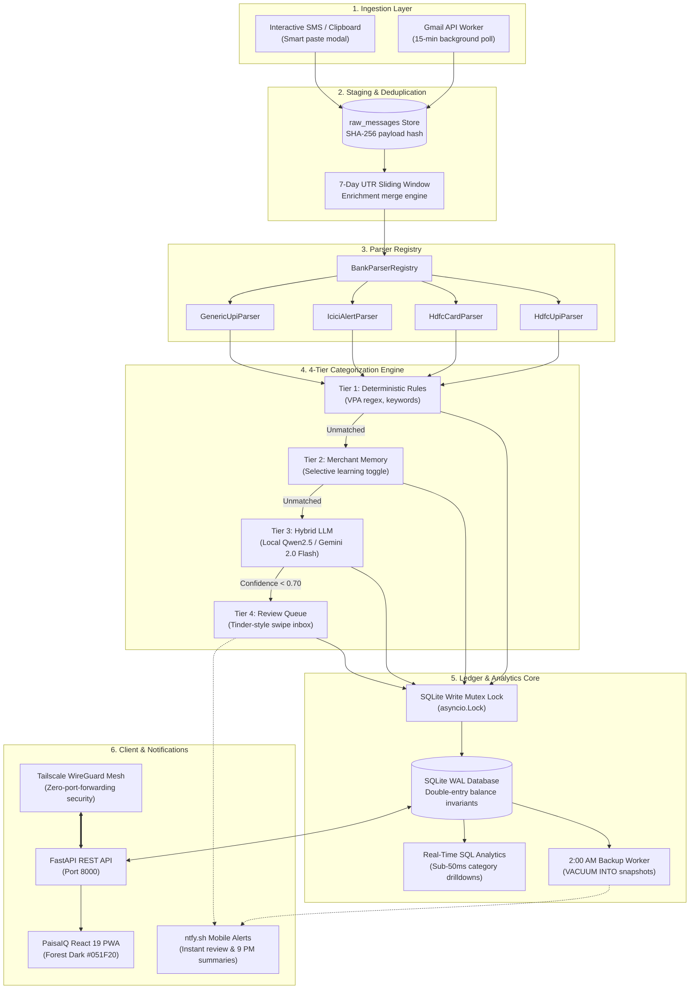

# PaisaIQ / Expense Tracker v2.0 💸

[](https://www.python.org/)
[](https://fastapi.tiangolo.com/)
[](https://react.dev/)
[](https://tailwindcss.com/)
[](https://www.sqlite.org/)
[](https://www.docker.com/)
[](#-testing--verification)
[](LICENSE)

A **100% private, self-hosted personal finance operating system** engineered specifically for Indian financial workflows. Combines background Gmail notification ingestion, instant on-demand bank SMS parsing, cryptographic cross-channel deduplication, a 4-tier hybrid AI categorization engine, and an offline-first **PaisaIQ Progressive Web App (PWA)** in a custom Forest Dark theme.

---

## 🏛️ System Architecture



---

## 🚀 Key Features

### 1. Dual-Channel Ingestion & Cryptographic Deduplication
- **Automated Background Email Ingestion**: Polls Gmail API every 15 minutes using non-blocking worker threads (`asyncio.to_thread`) without stalling the async event loop.
- **Smart SMS Clipboard Parser**: Instant manual entry for pasted bank notifications (e.g. from HDFC, ICICI, SBI).
- **Cross-Channel UTR Reconciliation**: 7-day sliding window correlation matching bank Reference Numbers (UTRs). When an instant SMS paste is followed by an official bank email, the system executes a **non-destructive enrichment merge** rather than creating duplicate transactions.

### 2. 4-Tier Hybrid Categorization Cascade
1. **Tier 1 (Deterministic Rules)**: User-defined regex and keyword patterns resolved with 0ms latency.
2. **Tier 2 (Merchant Memory with Selective Learning)**: Automatically learns your category assignments. Features a **Selective Learning switch** and an **"Always Ask" (Never Auto-Classify)** flag for friends, family, and variable P2P merchants.
3. **Tier 3 (Hybrid LLM Engine)**: Supports primary local inference via `llama.cpp` (`Qwen2.5-1.5B`) with circuit-breaker failover to **Google Gemini 2.0 Flash** via Google AI Studio.
4. **Tier 4 (Review Inbox)**: Routes low-confidence (< 70%) transactions to an interactive review queue.

### 3. Double-Entry Multi-Account Ledger & Peer Splits
- **Multi-Account Support**: Tracks Savings accounts, Credit Cards, UPI IDs, and Cash balances with strict double-entry balance updates.
- **Transfer Invariant**: Intra-account transfers (e.g., credit card bill payments, ATM cash withdrawals) rebalance accounts without inflating expense burn rates.
- **Line-Item Splits**: Split a grocery or department store transaction across multiple categories ($\sum \text{Splits} = \text{Amount}$).
- **Peer Debt Splits**: Built-in Splitwise-style group bill splitting with 1-tap settlement tracking.

### 4. PaisaIQ Progressive Web App (PWA)
- **Forest Dark Theme**: Bespoke visual palette (`#051F20`, `#0B2B26`, `#DAF1DE`) with glowing accents and OLED mobile optimization.
- **Tinder-Style Review Deck**: Swipe left to review, swipe right to approve, or tap quick category badges.
- **Keypad-First Calculator**: Large numeric keypad for instant cash or manual transaction entry.
- **Stickman Financial Persona**: Animated SVG mascot reflecting financial discipline and daily burn status.
- **Offline Mutation Buffering**: TanStack Query + browser IndexedDB buffer offline entries and sync upon reconnection.

### 5. Production Hardening & Home Server Ready
- **Zero-Downtime SQLite Backups**: Automated daily 2:00 AM `VACUUM INTO` snapshots with 30-day retention rotation and SQLite concurrency write mutex locking.
- **Instant Mobile Push Alerts**: Integrates with `ntfy.sh` for push alerts when items need manual review and sends 9:00 PM daily spending summaries.
- **Tailscale Mesh Networking**: End-to-end encrypted remote access from your phone with **zero open ports** on your home router.
- **Single-Container Deployment**: Multi-stage Docker packaging serving both the FastAPI REST backend and compiled PaisaIQ static assets from a single port.

---

## 🛠️ Tech Stack

| Domain | Technology | Description |
| :--- | :--- | :--- |
| **Backend Framework** | [FastAPI](https://fastapi.tiangolo.com/) | Async REST API with OpenAPI 3.1 documentation |
| **ORM & Database** | [SQLAlchemy 2.0](https://www.sqlalchemy.org/) + [aiosqlite](https://github.com/omnilib/aiosqlite) | Async SQLite with Write-Ahead Logging (`WAL`), foreign keys & busy timeouts |
| **Schedulers** | [APScheduler](https://apscheduler.readthedocs.io/) | Background async cron jobs (15m Gmail poll, 2:00 AM backup, 9:00 PM summary) |
| **AI Ingestion** | Google Gemini 2.0 Flash / Qwen2.5 | Hybrid categorization with circuit-breaker fallback |
| **Frontend UI** | [React 19](https://react.dev/) + [TypeScript](https://www.typescriptlang.org/) | Offline-first mobile PWA with dynamic viewport handling |
| **Styling** | [Tailwind CSS v4](https://tailwindcss.com/) | Custom Forest Dark theme with safe-area insets |
| **State & Cache** | [TanStack Query v5](https://tanstack.com/query) | Server state management with local storage persistence |
| **Charts & Icons** | [Recharts](https://recharts.org/) + [Lucide](https://lucide.dev/) | Interactive category donut charts, daily bar charts, drilldown sheets |
| **Containerization** | [Docker](https://www.docker.com/) & Docker Compose | Multi-stage build (< 200MB image) with automated healthchecks |
| **Networking** | [Tailscale](https://tailscale.com/) | WireGuard-based private mesh VPN for phone access without port forwarding |

---

## 🏁 Quickstart

### Method 1: Docker Compose (Recommended)

The easiest way to run Expense Tracker in production on any Linux machine, macOS, or repurposed laptop:

1. **Clone the repository**:
   ```bash
   git clone https://github.com/akkolluru/Expense-Tracker.git
   cd Expense-Tracker
   ```

2. **Configure environment**:
   ```bash
   cp .env.example .env
   ```
   Generate a strong random server key and update `.env`:
   ```bash
   python3 -c "import secrets; print(secrets.token_hex(24))"
   ```
   Edit `.env` to supply:
   - `SERVER_API_KEY`: The generated key.
   - `GEMINI_API_KEY`: (Optional) Free tier key from [Google AI Studio](https://aistudio.google.com/).
   - `NTFY_TOPIC`: (Optional) Unique topic for mobile push notifications.

3. **Start the application**:
   ```bash
   docker compose up -d --build
   ```

4. **Access the application**:
   - Open `http://localhost:8000` in your browser.
   - API Docs: `http://localhost:8000/docs`.

---

### Method 2: Local Development Setup

#### Backend Setup
```bash
cd backend
python3 -m venv .venv
source .venv/bin/activate
pip install -e ".[dev]"

# Run database migrations
alembic upgrade head

# Start FastAPI dev server
uvicorn expense_tracker.api.app:create_app --factory --reload --port 8000
```

#### Frontend Setup
```bash
cd frontend
npm install
npm run dev
```
Open `http://localhost:3000` (proxied to backend on port 8000).

---

## 💻 Deploying on an Old Laptop (Home Server)

For detailed step-by-step instructions on converting an old Linux laptop into a silent, 24/7 autonomous finance server, see the dedicated guide:

👉 **[docs/DEPLOYMENT_GUIDE_LAPTOP.md](file:///Users/kaushik/Projects/Expense%20Tracker/docs/DEPLOYMENT_GUIDE_LAPTOP.md)**

Key setup covered in the guide:
- **Preventing Sleep on Lid Close**: Configure `/etc/systemd/logind.conf` (`HandleLidSwitch=ignore`).
- **Tailscale Setup**: Access your finance dashboard securely from your mobile phone anywhere in the world.
- **PWA Installation on iOS & Android**: Install PaisaIQ as a native full-screen app via Safari or Chrome.
- **Automated Backups & Disaster Recovery**: SQLite `VACUUM INTO` snapshots and restore workflows.

---

## 🧪 Testing & Verification

The project enforces strict automated testing across both backend and frontend layers:

```bash
# 1. Run all 66 Backend Python Tests
cd backend
source .venv/bin/activate
pytest tests/ -v

# 2. Run Python Linting & Type Checking
ruff check src/ tests/
mypy src/

# 3. Run all 127 Frontend Vitest Tests
cd ../frontend
npm test -- --run

# 4. Run Frontend TypeScript Compilation & Build
npm run lint
npm run build
```

**Verification Summary**:
- **Backend Tests**: 66 passed (Ledger invariants, UTR deduplication, parsers, LLM fallback, backups, scheduler, notifications, SPA static serving).
- **Frontend Tests**: 127 passed across 12 test suites (Components, hooks, offline queues, adapters, modals, Mascot).
- **Total Test Suite**: **193 automated tests passing**.

---

## 📁 Repository Structure

```
Expense Tracker/
├── Dockerfile                  # Multi-stage production container build
├── docker-compose.yml          # Container orchestration with volumes & healthchecks
├── .dockerignore               # Optimized Docker build context exclusions
├── .env.example                # Environment variable configuration template
├── README.md                   # Master project documentation
│
├── backend/                    # Headless FastAPI REST backend
│   ├── alembic/                # Database migrations
│   ├── pyproject.toml          # Python package specifications & dependencies
│   ├── src/expense_tracker/
│   │   ├── api/                # FastAPI routers, dependencies, and Pydantic schemas
│   │   ├── models/             # SQLAlchemy 2.0 async domain models
│   │   ├── parsers/            # Pluggable bank parser registry (HDFC, ICICI, Generic)
│   │   ├── services/           # Ledger, Categorization, Staging, Analytics, Backup, Notifications
│   │   ├── workers/            # APScheduler background cron & interval jobs
│   │   ├── concurrency.py      # SQLite write mutex locking (asyncio.Lock)
│   │   └── database.py         # SQLite engine, connection pooling, and pragmas
│   └── tests/                  # 66 comprehensive async pytest suites
│
├── frontend/                   # PaisaIQ React 19 + Tailwind CSS v4 PWA
│   ├── src/
│   │   ├── components/         # HomeView, InboxView, ExpensesView, AnalyticsView, Modals
│   │   ├── hooks/              # TanStack Query hooks (useExpenseApi, useNetworkStatus)
│   │   ├── services/           # Typed API client and IndexedDB offline queue
│   │   ├── utils/              # Data formatting, currency INR, and adapters
│   │   ├── App.tsx             # Responsive phone canvas envelope
│   │   └── main.tsx            # PWA entry point
│   └── package.json            # Node.js dependencies and scripts
│
└── docs/                       # Authoritative engineering documentation
    ├── DEPLOYMENT_GUIDE_LAPTOP.md # Linux laptop headless operations manual
    ├── ARCHITECTURE.md         # Detailed architectural seams & sequence diagrams
    ├── DATA_MODEL.md           # Entity relationship diagrams & SQL schemas
    ├── API_SPEC.md             # REST API contracts & JSON schemas
    ├── CATEGORIZATION_ENGINE.md# 4-tier decision cascade & merchant memory
    ├── PARSER_PIPELINE.md      # Bank parsing protocol & UTR deduplication
    ├── ROADMAP_AND_MILESTONES.md # Complete 7-phase roadmap record
    ├── SESSION_HANDOFF.md      # Granular milestone progress tracking
    ├── adr/                    # 9 Architectural Decision Records (ADRs 0001 - 0009)
    └── tickets/                # Atomic implementation tickets (00 - 12)
```

---

## 📚 Complete Documentation Index

| Document | Purpose |
| :--- | :--- |
| **[Old Laptop Deployment Guide](file:///Users/kaushik/Projects/Expense%20Tracker/docs/DEPLOYMENT_GUIDE_LAPTOP.md)** | Step-by-step operations manual for deploying 24/7 on Linux with Tailscale |
| **[Product Requirements Document](file:///Users/kaushik/Projects/Expense%20Tracker/docs/PRD.md)** | User personas, functional requirements, and success metrics |
| **[System Architecture](file:///Users/kaushik/Projects/Expense%20Tracker/docs/ARCHITECTURE.md)** | System seams, failure handling, and network topology |
| **[Data Model & ERD](file:///Users/kaushik/Projects/Expense%20Tracker/docs/DATA_MODEL.md)** | Complete database table schemas, relationships, and indexes |
| **[REST API Specification](file:///Users/kaushik/Projects/Expense%20Tracker/docs/API_SPEC.md)** | Endpoint definitions, request/response models, and status codes |
| **[Categorization Engine](file:///Users/kaushik/Projects/Expense%20Tracker/docs/CATEGORIZATION_ENGINE.md)** | 4-tier categorization rules, merchant memory, and LLM failover |
| **[Parser Pipeline](file:///Users/kaushik/Projects/Expense%20Tracker/docs/PARSER_PIPELINE.md)** | Regex patterns, bank payload staging, and UTR deduplication |
| **[Architectural Decision Records (ADRs)](file:///Users/kaushik/Projects/Expense%20Tracker/docs/adr/)** | Master index of 9 recorded architectural decisions |
| **[Tickets Catalog](file:///Users/kaushik/Projects/Expense%20Tracker/docs/tickets/)** | Complete execution tickets from Ticket 00 to Ticket 12 |

---

## ⚖️ License

Distributed under the MIT License. See `LICENSE` for more information.
